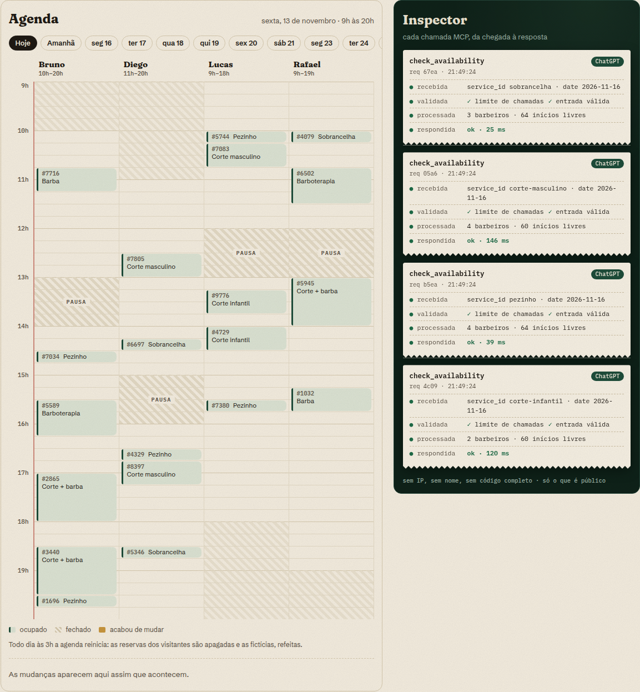
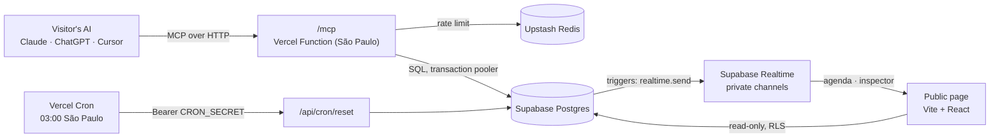

# MCP Barber Shop

A fictional barbershop whose booking system is a **remote MCP server**. Connect it to the AI you already use
(Claude, ChatGPT, Cursor…), book a haircut by chatting, and watch it happen on a public page: the agenda is
shared by every visitor and updates live, and an **inspector** shows each MCP call being received, validated,
processed and answered.

- Live page: https://mcp-barber-shop.vercel.app
- MCP endpoint: `https://mcp-barber-shop.vercel.app/mcp` (no login)

The shop's content is in Brazilian Portuguese (services, prices in BRL); your AI answers in your language.



## Try it

| Client | How to connect |
|---|---|
| Claude (claude.ai) | Settings → Connectors → Add custom connector. Paste the endpoint and set Authentication to none: Claude suggests OAuth by default, and this server has no login. |
| ChatGPT | chatgpt.com/plugins → Add → custom MCP server. Paste the endpoint, no authentication. Works on the free plan. |
| Cursor | Add to `~/.cursor/mcp.json`: `{ "mcpServers": { "mcp-barber-shop": { "url": "https://mcp-barber-shop.vercel.app/mcp" } } }` |
| Claude Code | `claude mcp add --transport http mcp-barber-shop https://mcp-barber-shop.vercel.app/mcp` |

Then, in a new conversation: *"I'd like a haircut tomorrow afternoon with Rafael. What times does he have?"* Book
it, keep the booking code your AI shows you, and open the link it gives you to see your booking on the agenda.
The demo resets every day at 03:00 São Paulo time: visitor bookings are deleted.

## What the server exposes

| Tool | Input | Output | Annotations |
|---|---|---|---|
| `list_services` | none | services with price, duration and who does each | read-only |
| `list_professionals` | none | professionals, their services and weekly hours | read-only |
| `check_availability` | `service_id`, `date`, `professional_id?` | free start times per professional | read-only |
| `book_appointment` | `service_id`, `start`, `professional_id?`, `client_name?` | booking `code`, the appointment, `watch_url` | |
| `get_appointment` | `code` | the appointment | read-only |
| `reschedule_appointment` | `code`, `new_start`, `professional_id?` | the updated appointment | |
| `cancel_appointment` | `code` | confirmation | destructive |

- **Resource `salon://info`**: a fictitious address, the opening hours of each weekday and the shop's policies, as
  Markdown. It is built on each read from the database's working hours and the rules in
  [`server/domain/rules.ts`](server/domain/rules.ts), so it never drifts from what the tools enforce.
- **Prompt `agendar_horario`** ("book an appointment", optional `service` argument): the visitor's request plus the
  steps the AI should follow: check services and availability, summarize and wait for an OK before booking,
  then show the booking code and the live agenda link.
- **Server instructions** tell the AI the time zone, to check availability before booking, never to invent
  services or prices, to show the booking code and to warn about the daily reset.
- **Errors** come back as tool results with `isError: true` and structured content `{ code, message, suggestions? }`:
  `SLOT_UNAVAILABLE` and `OUTSIDE_WORKING_HOURS` carry the three nearest free times, `RATE_LIMITED` says when to
  retry, and an unexpected failure is only `INTERNAL_ERROR` (the details stay in the server log).

Every input is validated with `zod`, with length and format limits. All times are ISO 8601 with offset, in
`America/Sao_Paulo`.

## Architecture



One repository holds both sides. The page is a Vite + React SPA; the server is a set of Vercel Functions in
[`api/`](api) with the Web signature (`export default { fetch }`), running in São Paulo next to the database. The
server code in [`server/`](server) is layered:

- `domain/`: the business rules as pure functions, with no database or HTTP: availability, booking checks, limits,
  time zones, suggestions, the fictitious bookings. `time.ts` and `rules.ts` are also imported by the page.
- `db/`: plain SQL with postgres.js. Rows read are validated with `zod`.
- `app/`: the use cases (book, reschedule, cancel, daily reset), which load data, ask the domain and write in one
  transaction.
- `mcp/`: tools, resource, prompt and instructions.
- `events/`: the inspector's trace of each call, sanitized before it is stored.
- `security/`: rate limit, visitor identification, booking codes, body size limit, the cron guard.

**A booking, end to end.** The MCP endpoint is stateless: protocol 2026-07-28 natively, plus the stateless
Streamable HTTP fallback for 2025-era clients, both from one handler (`mcp-handler` with the official SDK v2).

1. A body over 64 KB is refused with 413 before the SDK parses it.
2. The rate limit counts the call against the visitor (Redis).
3. The arguments are validated with the same `zod` schema the tool advertises.
4. The domain plans the booking from a snapshot of the schedule: a service the professional does, working hours,
   the 15-minute grid, closures, notice and horizon. Without a chosen professional, it picks one who is free.
5. One transaction takes advisory locks in a fixed order (visitor, day, professional), checks the business
   limits and inserts the row. Postgres refuses any overlap for a professional (an exclusion constraint). If
   someone took the time a moment earlier, the plan runs again with fresh data, up to three attempts: another
   professional may still be free, or the new plan fails with the nearest free times.
6. The visitor gets a booking code; only its SHA-256 hash is stored.
7. All the inspector steps of the call are written in one insert, before the answer.

**Real time comes from the database.** Triggers on `appointments` and `mcp_events` call `realtime.send` inside the
same transaction as the write: a rollback broadcasts nothing, and the server needs no Supabase key. The page
loads its initial data straight from Supabase (read-only, through RLS) and then listens on two private
channels, `agenda` and `inspector`.

**The daily reset.** Vercel Cron calls `GET /api/cron/reset` at 06:00 UTC (03:00 in São Paulo). In one
transaction, which starts by locking writes to `appointments` (reads go on), it:

1. deletes the visitor bookings;
2. syncs the shop's own fictitious bookings for today and the next 14 days;
3. marks the bookings that already ended as completed;
4. deletes inspector events older than 7 days.

The fictitious bookings fill about 30% of each day. A generator seeded with the date picks them, so the same day
always gets the same bookings and each run only adds the new last day; running it twice changes nothing. They
follow the rules a visitor follows and have no booking code, so nobody can view, move or cancel them.

## Business rules

| Rule | Value |
|---|---|
| Time zone | `America/Sao_Paulo` |
| Slot grid | 15 minutes |
| Minimum notice to book | 2 hours |
| Booking horizon | 14 days |
| Minimum notice to reschedule or cancel | 2 hours |
| Active bookings per visitor (IP) | 2 (not applied to AI platforms' addresses, see below) |
| Day closes to new visitor bookings at | 70% of its working minutes, fictitious bookings included |
| Fictitious bookings | about 30% of each day, recreated daily |
| Suggestions when a time is taken | the 3 nearest free times |

Each service has its own duration and price, and the server computes every end time. Not every professional
does every service. Working hours allow several intervals per day (lunch breaks). Closures block one
professional or the whole shop.

## Design decisions

- **The visitor brings the AI.** There is no embedded chat, so the project pays for no LLM inference, and the
  demo proves the server works with the clients people actually use.
- **No login; the booking code is the key.** Ten random Crockford base32 characters (50 bits), formatted
  `XXXXX-XXXXX`, forgiving of case, dashes and look-alike letters. Only the hash is stored.
- **The guarantees live in Postgres.** No double booking (exclusion constraint), the limits checked inside the
  booking's transaction, RLS on every table, privileges revoked by default. Plain SQL instead of an ORM, because
  an ORM models none of this well. `tests/db` fails if any of it is removed.
- **`public_agenda` runs with its owner's privileges, on purpose.** The view is created with
  `security_invoker = false`, which the Supabase linter flags. Here it is the point: the `anon` role (the page)
  has no access at all to `appointments`, and the view is its only window into the agenda, with only the public
  columns (no name, no IP hash, no code hash) and without cancelled rows.
- **Time limits in Redis, business limits in Postgres.** The per-minute and per-hour windows are counters, cheap
  in Redis. The booking limits must hold under concurrency, so they are checked in the same transaction as the
  write.
- **AI platforms are many visitors.** The connectors of claude.ai and ChatGPT call the server from the platform's
  cloud, not from the visitor's device, so one of their addresses stands for many people. Addresses in
  Anthropic's published egress ranges or OpenAI's `chatgpt-connectors.json` list (a copy is kept in the
  repository) get a higher rate limit and no per-visitor booking limit; the daily cap and the reset apply to
  everyone. Clients that call directly (Claude Code, Cursor) are limited by their own address.
- **A deterministic, rolling demo.** The daily reset keeps the agenda believable and bounded, and as a side effect
  keeps the free Supabase project from pausing after 7 idle days.
- **Two languages, split by reader.** What the visitor sees is in Brazilian Portuguese: the page, the shop
  content, the resource, the prompt (picked from a menu and sent in the visitor's name). What only the AI reads is
  in English: tool descriptions, server instructions, error messages. Code identifiers are in English.
- **Times stored as `timestamptz`**, converted to São Paulo time only at the edges.
- **Pinned MCP dependencies** (`mcp-handler`, `@modelcontextprotocol/server`, `zod`), upgraded together after
  checking that the three are compatible.

## Threat model

| Threat | Mitigation |
|---|---|
| Taking over someone else's booking | 50-bit random codes, stored only as SHA-256. The inspector shows the first 2 characters. Guessing is also bounded by the rate limit. |
| Double booking under concurrency | Exclusion constraint on (professional, time range) for active bookings; a conflict replans with fresh data. A test fires simultaneous bookings at one slot and expects exactly one to succeed. |
| Beating the limits with parallel requests | Advisory locks in a fixed order (visitor, day, professional) in the booking's transaction, with race tests against a real database. |
| One visitor filling the agenda | 2 active bookings per visitor, 10 writes per hour, and each day closes to visitors at 70%. |
| Call flooding | 30 tool calls per minute per address (120 for AI platforms), counted in Redis; bodies over 64 KB get 413. IPv6 addresses count per /64 network. |
| Holding requests open | No request waits on the client: the server promises no list changes and refuses `subscriptions/listen`, so no stream stays open until Vercel's 300 s limit; GET and DELETE get 405 (stateless). |
| Spoofing the visitor's address | Only the Vercel proxy's headers are trusted, which Vercel overwrites on every request. |
| Reading private data from the page | RLS and grants: `anon` reads only the catalog, closures, inspector events and the `public_agenda` view; `authenticated` gets nothing. No free text typed by a visitor is ever shown publicly. |
| Exposing visitors in the inspector | Arguments pass only when they match the format the tool expects (ids, dates, times); anything else shows as `•••`. The name is dropped, the code masked, the IP never stored: only an HMAC-SHA256 of it with a secret salt, used for the limits. |
| Forging live updates for other visitors | Private Realtime channels; a policy on `realtime.messages` lets `anon` only listen to `agenda` and `inspector`. Broadcasts come only from database triggers. |
| One visitor's text reaching another visitor's AI | Free text (the optional name) is never returned to anyone else nor shown on the page. Aliases (`Cliente #NNNN`) are generated by the server. |
| Leaking internals in errors | Unexpected failures answer `INTERNAL_ERROR`; the log keeps the stack and error code, not the error's other properties (Node's URL errors carry the whole connection string). A failed resource read is wrapped too: the SDK would send the raw message. |
| Calling the reset endpoint | `Authorization: Bearer <CRON_SECRET>`, compared in constant time over hashes, checked before any database access. A missing secret, or one under 16 characters, makes the endpoint fail instead of accepting it. |
| Leaked credentials | Secrets only in environment variables. The page's Supabase key is the publishable one, public by design and limited by RLS; the server uses no Supabase key at all. |
| Redis outage | The rate limit fails open after 1 second and logs it; the business limits in Postgres still hold. |

**Accepted risks.**

- People behind one address (an office, mobile carrier NAT) share the per-visitor limits.
- The platform address lists can age: a new address of an AI platform only gets the limits of one visitor.
- The booking code is a bearer token: whoever has it controls the booking. That is the trade-off of having no
  login.
- The client name in the inspector is self-declared: it is shown only as a label, for a known list of clients,
  and never used for any decision. claude.ai calls with Claude Code's MCP client and declares "Claude Code";
  its `Claude-User` User-Agent is what labels it "Claude".
- The handshake, listings and resource reads are not rate limited. They read only public data, the same the page
  reads from Supabase.

## Running locally

Requirements: Node 22, pnpm, and Docker (for the local Supabase).

```sh
pnpm install
pnpm db:start              # local Supabase: db, api, studio, realtime
cp .env.example .env.local # then set VITE_SUPABASE_PUBLISHABLE_KEY from `pnpm exec supabase status`
pnpm db:reset              # apply the migrations and the seed
pnpm dev                   # page and /api on http://localhost:5173, MCP at /mcp
```

Connect a local client with `claude mcp add --transport http barber-local http://localhost:5173/mcp`. Without the
Redis variables, the local server uses an in-memory rate limiter.

Environment variables (never committed; `.env.local` locally, the Vercel dashboard in production):

| Variable | Used by |
|---|---|
| `DATABASE_URL` | server (production: Supabase transaction pooler) |
| `VITE_SUPABASE_URL`, `VITE_SUPABASE_PUBLISHABLE_KEY` | page (public by design) |
| `KV_REST_API_URL`, `KV_REST_API_TOKEN` | server, rate limit (Upstash) |
| `IP_HASH_SALT` | server, visitor identification |
| `CRON_SECRET` | daily reset |

## Tests

```sh
pnpm typecheck && pnpm lint
pnpm test       # domain, MCP layer and page (Vitest; the page in jsdom)
pnpm test:db    # against the local Supabase
```

- **Domain**: availability, notice and horizon, time zones, suggestions, limits, the fictitious bookings.
- **MCP**: a real SDK client talks to the handler: tools, errors, resource, prompt, rate limit, body limit.
- **Database**: the concurrency race, the limit locks, RLS and grants, Realtime delivery and policies, the
  inspector's events and the daily reset. Each test runs in a rolled-back transaction or with data of its own,
  and the helper refuses any database that is not local.
- **Page**: the agenda, the inspector and the "try it" section, with Testing Library.

Every protection was also broken on purpose to see its test fail.

## Project layout

```
api/              Vercel Functions: mcp.ts, health.ts, cron/reset.ts
server/
  domain/         business rules, pure functions
  db/             SQL access
  app/            use cases
  mcp/            tools, resource, prompt, instructions
  events/         inspector traces
  security/       rate limit, IP hashing, codes, body limit, cron guard
src/              the public page (Vite + React)
supabase/         migrations and seed
tests/            unit, MCP, page and database tests
dev/              Vite plugin that serves /api locally like Vercel
docs/SPEC.md      the full specification (in Portuguese)
```

## Stack

TypeScript (strict) · Node 22 · Vite 8 + React 19 · Vercel Functions and Cron · `mcp-handler` 2.3.1 +
`@modelcontextprotocol/server` 2.4.0 + `zod` 4 · Supabase (Postgres + Realtime) with postgres.js · Upstash Redis ·
Vitest + Testing Library · oxlint · pnpm.

## License

MIT. See [LICENSE](LICENSE).
